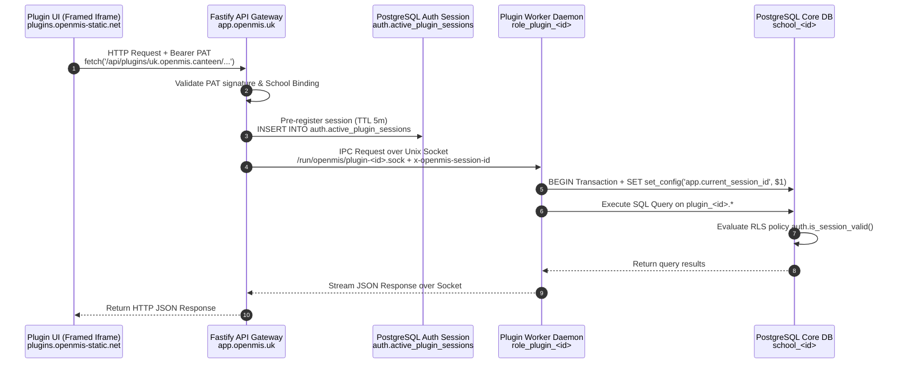
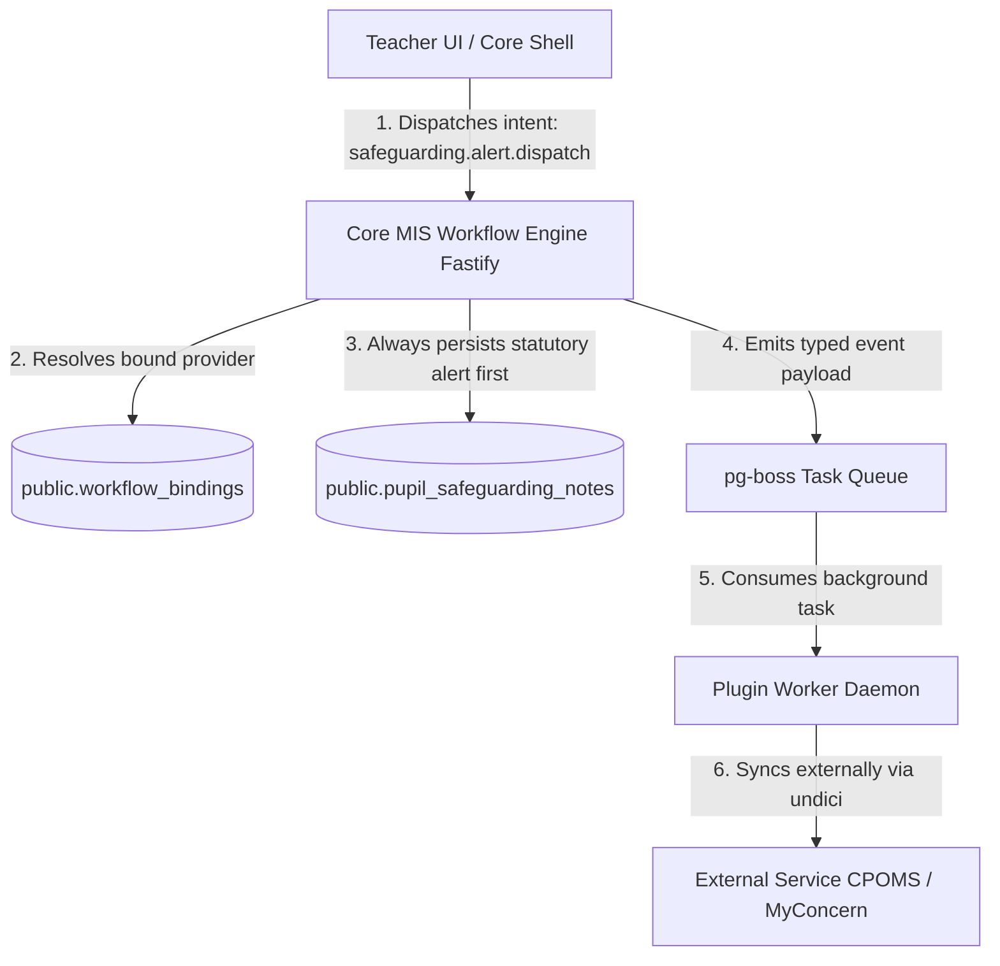

# OpenMIS UK: Architectural Specification & Reference Blueprint

> **Status:** Active Reference Blueprint  
> **Target Audience:** Engineering, AI Agents, Security Auditors  
> **Related Specifications:** [Architecture](./architecture.md) | [Security](./security.md) | [Performance](./performance.md)

---

## Table of Contents

- [1. Executive Summary & Core Paradigms](#1-executive-summary--core-paradigms)
  - [Primary Paradigm](#primary-paradigm)
  - [Core Tenancy Model: Dedicated Container & Database per School](#core-tenancy-model-dedicated-container--database-per-school)
  - [Data Plane Partitioning](#data-plane-partitioning)
  - [Security & Invariant Hierarchy](#security--invariant-hierarchy)
- [2. Core Backend & Infrastructure Blueprint](#2-core-backend--infrastructure-blueprint)
  - [Core Technology Stack](#core-technology-stack)
  - [Stack Comparison: OpenMIS UK vs. MedusaJS (v2)](#stack-comparison-openmis-uk-vs-medusajs-v2)
  - [Infrastructure & Deployment Models](#infrastructure--deployment-models)
- [3. Data Access & Defense-in-Depth Security](#3-data-access--defense-in-depth-security)
  - [Defense-in-Depth: Scopes Guarded in Front of DbContext](#defense-in-depth-scopes-guarded-in-front-of-dbcontext)
  - [Guarded Core DbContext Pattern](#guarded-core-dbcontext-pattern)
  - [Core Scope Hierarchy & Capability Model](#core-scope-hierarchy--capability-model)
  - [Effective Scope Resolution Formula](#effective-scope-resolution-formula)
- [4. Architectural Patterns Adapted from MedusaJS](#4-architectural-patterns-adapted-from-medusajs)
  - [A. The Remote Link Pattern (Decoupled References)](#a-the-remote-link-pattern-decoupled-references)
  - [B. Compensation-Aware Workflows (Sagas)](#b-compensation-aware-workflows-sagas)
  - [C. In-Process Dependency Injection](#c-in-process-dependency-injection)
- [5. Decoupled Plugin Execution Topology & IPC](#5-decoupled-plugin-execution-topology--ipc)
  - [Top-Level Execution Topology](#top-level-execution-topology)
  - [Package Digest & Token Binding](#package-digest--token-binding)
  - [Communication Patterns: Daemons & Queues](#communication-patterns-daemons--queues)
- [6. Declarative Schema Engine & Database Isolation](#6-declarative-schema-engine--database-isolation)
  - [Manifest-Driven Schema Model](#manifest-driven-schema-model)
  - [Registration & Zod Validation Rules](#registration--zod-validation-rules)
  - [Privilege Segregation & Provisioning Pipeline](#privilege-segregation--provisioning-pipeline)
- [7. Sandboxed UI Runtime & Frame Protocol Specification](#7-sandboxed-ui-runtime--frame-protocol-specification)
  - [Host Chrome vs. Framed Execution Surfaces](#host-chrome-vs-framed-execution-surfaces)
  - [Domain Isolation & Sandbox Directives](#domain-isolation--sandbox-directives)
  - [PostMessage RPC Protocol](#postmessage-rpc-protocol)
- [8. Egress Control & Network Governance](#8-egress-control--network-governance)
  - [Network Egress Control (undici.Agent)](#network-egress-control-undiciagent)
  - [Pragmatic Failure Governance: The Three-Strikes Rule](#pragmatic-failure-governance-the-three-strikes-rule)
- [9. Operational Lifecycle, Storage Sanitation & Worker Governance](#9-operational-lifecycle-storage-sanitation--worker-governance)
  - [School-Scoped Random Prefixing](#school-scoped-random-prefixing)
  - [Worker Governance & Queue Segregation](#worker-governance--queue-segregation)
  - [Stateless Cache Synchronization](#stateless-cache-synchronization)
- [10. Statutory Workflow Engine & Provider Bindings](#10-statutory-workflow-engine--provider-bindings)
  - [The Statutory Risk: Safeguarding as a Workflow Provider](#the-statutory-risk-safeguarding-as-a-workflow-provider)
  - [Core State Orchestration with "Hook Providers"](#core-state-orchestration-with-hook-providers)
  - [Concrete Contract Specification](#concrete-contract-specification)
  - [Categorizing Workflows by Risk Tier](#categorizing-workflows-by-risk-tier)
- [11. Frontend Architecture & Classroom UX](#11-frontend-architecture--classroom-ux)
- [12. AI Code Generation Strategy](#12-ai-code-generation-strategy)

---

## 1. Executive Summary & Core Paradigms

### Primary Paradigm

OpenMIS UK is an open-source, cloud-native statutory School Management Information System (MIS) tailored to the United Kingdom educational landscape (Department for Education / DfE compliance). It adopts MedusaJS (v2) strictly as an **architectural reference pattern** (modular boundaries, sagas, remote links, and in-process DI) rather than a direct code fork, eliminating commerce-specific domain baggage (e.g., carts, shipping, payments) and mismatched defaults (Express and MikroORM).

### Core Tenancy Model: Dedicated Container & Database per School

The platform enforces a strict single-tenant physical isolation model:

* Each school runs on its own dedicated application container (Fastify) and its own dedicated logical PostgreSQL database (`school_<id>`).
* Shared multi-tenant application tables, dynamic Row-Level Security (RLS) context switching, and shared multi-tenant application containers are eliminated.
* Complete container-level and database-level isolation at the deployment boundary prevents cross-school data leakage and eliminates cross-school resource contention.
* Multi-Academy Trusts (MATs) scale by provisioning distinct container and database pairings per school, utilizing hub-and-spoke REST APIs for cross-trust aggregate reporting.

### Data Plane Partitioning

* **Core Host DB (`public` schema):** Contains core student profiles, statutory roll-calls, attendance marks, timetables, and child protection notes (`pupil_safeguarding_notes`).
* **Plugin Isolated Schemas (`plugin_<id>`):** Third-party extensions (e.g., catering, library, clubs, transport) run within dedicated PostgreSQL schemas, completely isolated from statutory tables.
* **Controlled Statutory Core Access:** Plugins access non-safeguarding core data (e.g., pupil directories) via direct, column-restricted PostgreSQL database permissions (`GRANT SELECT (cols)`) assigned to dynamic per-plugin roles (`role_plugin_<id>`), eliminating complex IPC method serialization and in-memory payload pre-fetching.

### Security & Invariant Hierarchy

* **UI state is never trusted**.
* **Data Context Guards:** Capabilities are verified directly in front of the database context (`DbContext`), stopping privilege escalations even if an HTTP handler omits perimeter middleware.
* **Absolute Safeguarding Isolation:** Child protection records (`pupil_safeguarding_notes`) are unmapped in plugin contexts, structurally unreachable by third parties regardless of granted scopes or roles, and restricted to verified Designated Safeguarding Leads (DSLs).

---

## 2. Core Backend & Infrastructure Blueprint

### Core Technology Stack

* **Language & Runtime:** TypeScript (Node.js LTS) with strict static typing for deterministic compiler-driven AI feedback.
* **API Framework:** Fastify (high throughput, native JSON schema validation, lightweight middleware).
* **Data Access / ORM:** Drizzle ORM (zero-magic, type-safe SQL query builder without runtime tracking abstractions).
* **Database Engine:** PostgreSQL 16+ (managed cloud or containerized; ACID guarantees, JSONB extensibility, native audit triggers, temporal tables, row locking).
* **Validation Layer:** Zod (shared single source of truth across API boundary and client TypeScript inference).
* **Task Queue & Event Broker:** pg-boss running natively in PostgreSQL via `SKIP LOCKED`, avoiding Redis infrastructure.
* **Statutory XML Engine:** `fast-xml-parser` and `libxml-wasm` (pure TypeScript/Wasm for UK DfE Common Transfer Files [CTF XML] and School Census returns; eliminates native C++ toolchain dependencies).
* **Blob Storage Broker:** Native S3-compatible client wrapper (AWS S3, Cloudflare R2, Azure Blob) using presigned direct-to-cloud URLs, eliminating local proxy containers.
* **Emergency Snapshots:** In-memory PDF generation via `@react-pdf/renderer` or Typst, eliminating headless Chrome instances.

### Stack Comparison: OpenMIS UK vs. MedusaJS (v2)

| Architectural Dimension | OpenMIS UK (Target Specification) | MedusaJS (v2 Reference Pattern) |
| --- | --- | --- |
| **Primary Purpose** | Statutory School MIS, Attendance, Safeguarding | Modular Digital Commerce Engine |
| **Language & Runtime** | TypeScript on Node.js (LTS) | TypeScript on Node.js |
| **API Framework** | **Fastify** (high throughput, native JSON schema) | **Express-based** custom routing framework |
| **Data Access & ORM** | **Drizzle ORM** (zero-magic, thin SQL builder) | **MikroORM** (heavy Data-Mapper / Unit-of-Work) |
| **Task Queue / Events** | **pg-boss** (PostgreSQL native `SKIP LOCKED`, no Redis) | Event bus typically backed by **Redis** or in-memory |
| **Deployment Topology** | Dedicated container + DB per school (stateless OCI) | Modular Node container, Redis container, PostgreSQL |

### Infrastructure & Deployment Models

* **Cloud Architecture (GDS / DfE Aligned):**
  * **Edge/WAF:** AWS CloudFront or Azure Front Door terminating TLS, providing DDoS protection, and serving static SPA assets.
  * **Compute:** Stateless Fastify containers on AWS ECS Fargate or Azure Container Apps in UK sovereign regions (`eu-west-2` London / UK South).
  * **Database:** AWS RDS / Azure Flexible Server PostgreSQL (one logical DB per school).
  * **Storage:** Encrypted S3/Blob storage with presigned URLs.
* **Local / Single-Node Topology:** Docker Compose stack with Caddy proxying ports 80/443 (automatic Let's Encrypt TLS), serving the static Vite SPA, forwarding requests to Fastify (port 3000), and routing to PostgreSQL 16.
* **Zero-Tollbooth Integration:** Direct OAuth 2.0 / OIDC client credentials for Local Authorities and third parties. Primary staff SSO integrates with Microsoft Entra ID and Google Workspace.

---

## 3. Data Access & Defense-in-Depth Security

### Defense-in-Depth: Scopes Guarded in Front of DbContext

Perimeter guards at UI and HTTP route layers are insufficient for three reasons:

1. **Never Trust the Client:** Client-side state and hidden buttons provide zero security enforcement.
2. **AI Code Generation Hazards:** LLM-generated Fastify route handlers may omit perimeter authorization hooks.
3. **Internal Sagas & Workers:** Background workers and saga orchestrations bypass perimeter HTTP middleware entirely.

### Guarded Core DbContext Pattern

Table operations in the Core Host DB are gated by verified cryptographic capabilities before queries are issued to Drizzle:

```typescript
// src/core/db/guarded-core-context.ts
import { NodePgDatabase } from 'drizzle-orm/node-postgres';
import { eq } from 'drizzle-orm';
import * as schema from '../schema/core';

export interface CallerContext {
  userId: string;
  scopes: string[]; // Cryptographically verified from JWT/OIDC
}

export class GuardedCoreDbContext {
  constructor(
    private db: NodePgDatabase<typeof schema>,
    private caller: CallerContext
  ) {}

  private assertScope(requiredScope: string, operationName: string) {
    if (!this.caller.scopes.includes(requiredScope)) {
      throw new Error(
        `Security Exception: Caller lacks scope '${requiredScope}' required for '${operationName}'`
      );
    }
  }

  async recordAttendance(data: typeof schema.attendanceMarks.$inferInsert) {
    this.assertScope('attendance:write', 'recordAttendance');
    return this.db.insert(schema.attendanceMarks).values(data).returning();
  }

  async getSafeguardingRecord(pupilId: string) {
    this.assertScope('safeguarding:read:dsl', 'getSafeguardingRecord');
    return this.db.query.pupilSafeguardingNotes.findFirst({
      where: eq(schema.pupilSafeguardingNotes.pupilId, pupilId),
    });
  }

  async getPupilDirectory(pupilId: string) {
    this.assertScope('core:pupil:identity:read', 'getPupilDirectory');
    return this.db.query.pupils.findFirst({
      where: eq(schema.pupils.id, pupilId),
      columns: { id: true, upn: true, firstName: true, lastName: true, yearGroup: true },
    });
  }
}
```

### Core Scope Hierarchy & Capability Model

* **Safeguarding Domain:** `safeguarding:read:dsl`, `safeguarding:write:dsl` (gates `pupil_safeguarding_notes`; requires authenticated DSL status).
* **Attendance Domain:** `attendance:read`, `attendance:write` (statutory registers, persistent absence metrics, roll-call marks).
* **Pupil Identity Domain:** `core:pupil:identity:read` (`id`, `upn`, `first_name`, `last_name`, `year_group`), `core:pupil:medical:read` (`dietary_requirements`, `medical_flags`).
* **Statutory Integration Domain:** `statutory:dfe:sync` (automated daily attendance sync, School Census XML serialization).

### Effective Scope Resolution Formula

Plugins execute against a strict intersection model:

$$\text{Effective Scopes} = \text{Manifest Declared Scopes} \cap \text{Authenticated User Capabilities}$$

---

## 4. Architectural Patterns Adapted from MedusaJS

### A. The Remote Link Pattern (Decoupled References)

* Cross-module foreign keys (`REFERENCES`) are prohibited across domain/plugin boundaries.
* Plugin private schemas reference core entities (e.g., `pupil_id`) strictly as scalar UUIDs.
* Plugins can be installed, updated, or purged via `DROP SCHEMA ... CASCADE` without schema modifications or dangling constraints on core statutory tables.

### B. Compensation-Aware Workflows (Sagas)

* Multi-step operations crossing boundaries (e.g., student off-rolling, canteen balance refunds) execute as Directed Acyclic Graphs (DAGs).
* If an intermediate step fails, compensation handlers execute in reverse order to restore consistency without long-lived database locks.

### C. In-Process Dependency Injection

* Modules, repositories, and connection pools register into an in-process container (Awilix-style).
* Fastify boots plugins in-process under strict encapsulation, avoiding distributed container sprawl.

---

## 5. Decoupled Plugin Execution Topology & IPC

### Top-Level Execution Topology



### Package Digest & Token Binding

Bundle assets are hashed into an immutable digest verified at runtime:

$$\text{PackageDigest} = \text{SHA256}(\text{manifest.json} \parallel \text{client.bundle.js} \parallel \text{worker.bundle.js})$$

The gateway issues short-lived (5–15 minute) Plugin Access Tokens (PATs) bound to `school_id`, `plugin_id`, and `pkg_digest`.

### Communication Patterns: Daemons & Queues

1. **Interactive Path (Persistent Worker Daemons over Unix Domain Socket):**
   * High-throughput read/write operations route to persistent daemon child processes listening on local Unix Domain Sockets (`/run/openmis/plugin-<id>.sock`).
   * Daemons run with `--max-old-space-size=64`, RSS bounded to ~30–35 MB, and undergo soft restarts after 10,000 requests.
2. **Asynchronous Queue Broker (`pg-boss`):**
   * Heavy mutations and batch processing enqueue to `plugin:<id>`, consumed asynchronously by background worker workers using `role_plugin_<id>`.

---

## 6. Declarative Schema Engine & Database Isolation

### Manifest-Driven Schema Model

Plugins define their relational structures declaratively in `manifest.json`. Direct runtime DDL and ad-hoc migration scripts are prohibited:

```json
{
  "id": "uk.openmis.canteen",
  "version": "1.1.0",
  "schema": {
    "tables": {
      "meals": {
        "columns": {
          "id": { "type": "uuid", "primaryKey": true },
          "name": { "type": "text", "nullable": false },
          "price": { "type": "numeric", "precision": 10, "scale": 2 },
          "is_vegetarian": { "type": "boolean", "default": false },
          "created_at": { "type": "timestamptz", "default": "now()" }
        },
        "indexes": [
          { "columns": ["name"], "unique": true }
        ]
      },
      "transactions": {
        "columns": {
          "id": { "type": "uuid", "primaryKey": true },
          "pupil_id": { "type": "uuid", "nullable": false },
          "amount": { "type": "numeric", "precision": 10, "scale": 2 },
          "meal_id": { "type": "uuid", "references": "meals(id)" }
        }
      }
    }
  }
}
```

### Registration & Zod Validation Rules

* **Namespace Isolation:** All tables are scoped exclusively inside `plugin_<id>`.
* **System Keyword Blacklist:** Rejects reserved PostgreSQL system identifiers.
* **Strict Type Safety:** Restricts column types to primitives (`uuid`, `text`, `integer`, `numeric`, `boolean`, `timestamptz`).

### Privilege Segregation & Provisioning Pipeline

* **`openmis_app_user` (Host Fastify Gateway):** Zero DDL privileges; full access to core statutory tables and session management tables (`auth.active_plugin_sessions`).
* **`role_plugin_<id>` (Dedicated Plugin Worker Role):** Provisioned dynamically per plugin by `openmis_migrator` with `LOGIN, NOSUPERUSER, NOCREATEROLE, NOBYPASSRLS, NOINHERIT`. Full ownership of `plugin_<id>.*`, column-restricted `SELECT` on authorized core tables, zero access to safeguarding tables.
* **`openmis_migrator` (Lifecycle Runner):** Isolated worker executing schema creation, role creation, column grants, and atomic drops:

```sql
-- 1. Provision dedicated role and schema at activation
CREATE ROLE role_plugin_uk_openmis_canteen WITH LOGIN NOSUPERUSER NOCREATEROLE NOBYPASSRLS NOINHERIT CONNECTION LIMIT 5;
CREATE SCHEMA IF NOT EXISTS plugin_uk_openmis_canteen AUTHORIZATION role_plugin_uk_openmis_canteen;

-- 2. Grant plugin worker ownership on its schema
GRANT USAGE ON SCHEMA plugin_uk_openmis_canteen TO role_plugin_uk_openmis_canteen;
GRANT ALL PRIVILEGES ON ALL TABLES IN SCHEMA plugin_uk_openmis_canteen TO role_plugin_uk_openmis_canteen;

-- 3. Provision scoped column grants for statutory core access
REVOKE ALL ON public.pupils FROM role_plugin_uk_openmis_canteen;
GRANT SELECT (id, upn, first_name, last_name, year_group) ON public.pupils TO role_plugin_uk_openmis_canteen;

-- 4. Teardown
DROP SCHEMA plugin_uk_openmis_canteen CASCADE;
DROP OWNED BY role_plugin_uk_openmis_canteen;
DROP ROLE role_plugin_uk_openmis_canteen;
```

---

## 7. Sandboxed UI Runtime & Frame Protocol Specification

### Host Chrome vs. Framed Execution Surfaces

1. **Host Chrome (Native Entry Points):** Sidebar links, navigation buttons, and profile tabs are declared in `manifest.json` and rendered natively by the host shell (React 19 + Tailwind CSS).
2. **Framed Execution Surfaces:** Plugin UI code runs inside sandboxed iframes across full-page views, profile tabs, or dashboard widgets.

### Domain Isolation & Sandbox Directives

* **Origin Boundary:** Host application resides on `app.openmis.uk`. Plugin iframes are served exclusively from `plugins.openmis-static.net`.
* **Directives (`sandbox="allow-scripts allow-forms"`):**
  * Omission of `allow-same-origin` treats iframes as opaque origins, blocking access to host `document.cookie` and session storage.
  * Omission of `allow-top-navigation` and `allow-modals` neutralizes phishing redirects and modal spoofing.
  * CSP `connect-src https://api.openmis.uk/api/plugins/<id>/` restricts network activity exclusively to the host reverse proxy.

### PostMessage RPC Protocol

Cross-frame communication requires strict origin checks and payload validation:

```typescript
type MessageType =
  | 'INIT_HANDSHAKE'
  | 'HANDSHAKE_ACK'
  | 'RESIZE'
  | 'NAVIGATE'
  | 'THEME_SYNC'
  | 'FOCUS_EXIT_START'
  | 'FOCUS_EXIT_END';

interface PluginMessage<T = any> {
  type: MessageType;
  pluginId: string;
  payload: T;
  correlationId?: string;
}
```

---

## 8. Egress Control & Network Governance

### Network Egress Control (`undici.Agent`)

Outbound HTTP (`context.fetch`) runs through a custom Undici agent that pins connections to pre-validated public IPs to prevent SSRF and DNS rebinding:

```typescript
// host/src/worker/injected-fetch.ts
import dns from 'node:dns/promises';
import ipaddr from 'ipaddr.js';
import { Agent } from 'undici';

export function createInjectedFetch(manifestAllowedUrls: string[]) {
  const secureDispatcher = new Agent({
    connect: {
      lookup: async (hostname, options, callback) => {
        try {
          const addresses = await dns.resolve(hostname);
          if (!addresses.length) {
            return callback(new Error(`DNS lookup failed for ${hostname}`), null!, 4);
          }
          const targetIp = addresses[0];
          const parsed = ipaddr.parse(targetIp);

          // Block loopback, private RFC-1918/RFC-4193, and cloud metadata IPs
          if (parsed.range() !== 'unicast' || targetIp === '169.254.169.254') {
            return callback(
              new Error(`Security Violation: IP '${targetIp}' is restricted`),
              null!,
              4
            );
          }

          // Pin connection directly to validated IP
          callback(null, targetIp, 4);
        } catch (err: any) {
          callback(err, null!, 4);
        }
      },
    },
  });

  return async function injectedFetch(inputUrl: string, init?: RequestInit): Promise<Response> {
    const parsedUrl = new URL(inputUrl);
    if (parsedUrl.protocol !== 'https:') {
      throw new Error(`Security Violation: Only HTTPS is permitted (got ${parsedUrl.protocol})`);
    }

    const isAllowed = manifestAllowedUrls.some((prefix) => inputUrl.startsWith(prefix));
    if (!isAllowed) {
      throw new Error(`Security Violation: Destination '${inputUrl}' not in manifest.`);
    }

    return fetch(inputUrl, {
      ...init,
      redirect: 'manual',
      // @ts-expect-error undici dispatcher
      dispatcher: secureDispatcher,
    });
  };
}
```

### Pragmatic Failure Governance: The Three-Strikes Rule

Worker failures and poison pills are governed by an automated circuit breaker:

* When an unhandled child process exit or SIGKILL timeout occurs, an atomic counter (`plugin_restarts:<plugin_id>`) increments.
* If a plugin triggers **more than 3 fatal exits within 5 minutes**, the supervisor updates `public.active_plugins` to `status = 'SUSPENDED'`.
* Subsequent queue items for that plugin are discarded, and Fastify returns HTTP 423 Locked to the UI until administratively reviewed. Statutory operations continue uninterrupted.

---

## 9. Operational Lifecycle, Storage Sanitation & Worker Governance

### School-Scoped Random Prefixing

Upon activation, `openmis_migrator` generates a cryptographically secure GUID for isolated object storage:

```
s3://openmis-storage/schools/{school_id}/plugins/{plugin_id}-{guid}/
```

Plugins never receive direct cloud storage credentials; short-lived presigned URLs are issued server-side. Deactivation triggers a recursive prefix purge before database schemas are dropped.

### Worker Governance & Queue Segregation

* **Statutory Queue:** High-priority, dedicated capacity for DfE attendance rollups and Census export.
* **Plugin Worker Queue:** Isolated under `plugin:<plugin_id>:*` with lower thread scheduling priority, 60s hard timeouts, and a 500-task backlog cap per school.

### Stateless Cache Synchronization

TanStack Query frontend polling (60–120s) with HTTP Weak ETags; backend JIT checks against `public.active_plugins`.

---

## 10. Statutory Workflow Engine & Provider Bindings

### The Statutory Risk: Safeguarding as a Workflow Provider

Safeguarding cannot be treated like a generic modular service (e.g., swapping SMS notification providers). Under statutory frameworks (such as DfE *Keeping Children Safe in Education* / KCSIE):

* **Auditability & Ingestion:** The core MIS must **always own the primary write** of a safeguarding alert into `public.pupil_safeguarding_notes`.
* **Quarantine Invariant:** Safeguarding notes are unmapped in plugin contexts and physically unqueryable by `role_plugin_<id>` (`REVOKE ALL`).
* **The Invariant:** A third-party plugin cannot be the *sole record store* or direct executor for creating a core safeguarding record.

### Core State Orchestration with "Hook Providers"

The core host owns the workflow lifecycle state machine, and the plugin acts as a registered **Action / Dispatch Provider**:



### Concrete Contract Specification

#### A. Core Workflow Registry (Core Schema)

```sql
CREATE TABLE public.workflow_bindings (
  workflow_key TEXT PRIMARY KEY, -- e.g. 'safeguarding.alert.dispatch'
  bound_plugin_id TEXT REFERENCES public.active_plugins(plugin_id) ON DELETE SET NULL,
  fallback_strategy TEXT NOT NULL DEFAULT 'CORE_INTERNAL', -- 'CORE_INTERNAL' | 'FAIL_CLOSED'
  updated_at TIMESTAMPTZ NOT NULL DEFAULT NOW()
);
```

#### B. Plugin Manifest Declaration (`manifest.json`)

```json
{
  "id": "uk.openmis.myconcern-sync",
  "name": "MyConcern Safeguarding Connector",
  "provides": {
    "workflows": [
      {
        "intent": "safeguarding.alert.dispatch",
        "label": "Direct Sync to MyConcern Central Portal",
        "actionTarget": "syncAlertToExternalCaseSystem",
        "requiredScopes": ["safeguarding:dispatch"]
      }
    ]
  }
}
```

#### C. The Admin Selection UI

In school administrator settings (**Settings -> Statutory Workflows**), administrators select the active provider for each workflow key, updating `public.workflow_bindings.bound_plugin_id`. If uninstalled, foreign key `ON DELETE SET NULL` automatically cascades to core fallback.

### Categorizing Workflows by Risk Tier

| Workflow Type | Examples | Execution Model |
| --- | --- | --- |
| **Operational & Peripheral** (Pluggable) | • Send Parent SMS / Email<br/>• Canteen Balance Top-Up<br/>• Library Book Checkout | **Full Provider Delegation:** The bound plugin handles the transaction entirely inside its `plugin_<id>` schema. |
| **Statutory & Critical** (Observer Hook) | • Create Safeguarding Alert<br/>• Student Off-Rolling<br/>• Record Attendance Mark | **Core-First Mutation:** The core host writes the statutory audit row *first*. The bound plugin receives an asynchronous event via `pg-boss`. |

---

## 11. Frontend Architecture & Classroom UX

* **Core UI Stack:** React 19 + Vite SPA, Tailwind CSS semantic utilities, TanStack Table (v8), TanStack Query, native HTML forms validated with Zod, and HTML5 `<dialog>` elements.
* **Classroom-Optimized Workflows:** Fast-keyboard attendance registers (sub-4-minute completion), interactive seating charts with medical/SEN markers, and unified student profile timelines.

---

## 12. AI Code Generation Strategy

Engineering tasks follow a structured assembly-line pipeline:

1. **Drizzle DB Schema:** Declare structural database tables.
2. **Zod Contracts:** Define validation schemas and infer TypeScript types.
3. **Statutory TDD:** Author pure unit test suites for business logic (Census, persistent absence formulas).
4. **Implementation:** Construct Fastify route handlers or React components.
5. **Compiler Feedback Loop:** Run strict `tsc --noEmit` checks in CI. High-risk security logic is restricted to audited libraries and never generated ad-hoc.
