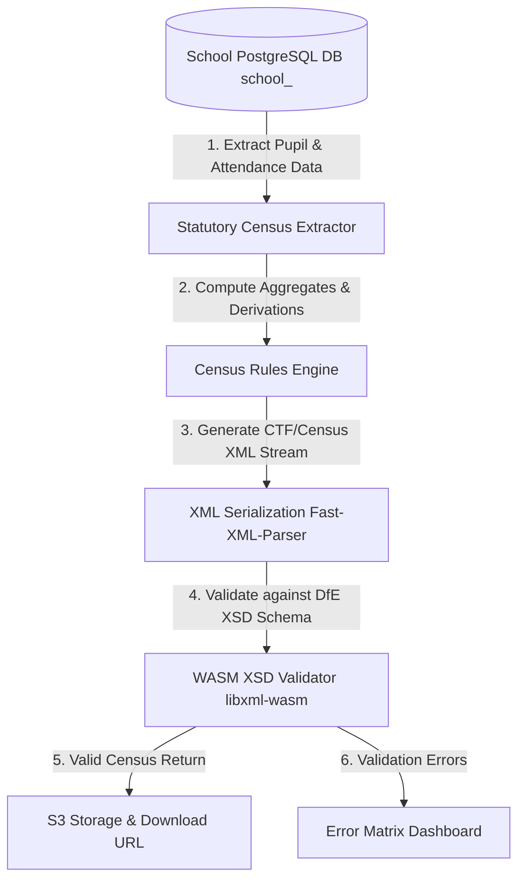
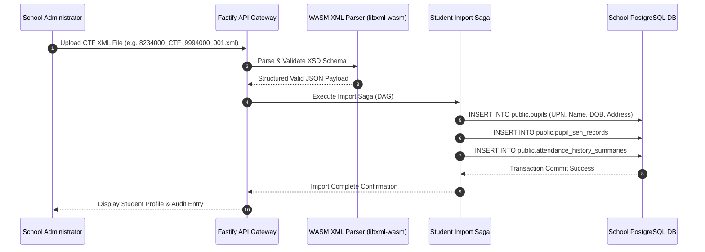

# OpenMIS UK: Statutory Compliance, Safeguarding & DfE Integration Specification

> **Status:** Active Reference Specification  
> **Target Audience:** Compliance Officers, Core Engineers, DfE Integration Specialists  
> **Related Specifications:** [Architecture](./architecture.md) | [Security](./security.md) | [Performance](./performance.md) | [Compliance](./compliance.md) | [Testing](./testing.md) | [Environments](./environments.md)

---

## Table of Contents

- [1. Executive Summary & Regulatory Framework](#1-executive-summary--regulatory-framework)
- [2. DfE School Census Engine Architecture](#2-dfe-school-census-engine-architecture)
  - [Census Cycle & Domain Scope](#census-cycle--domain-scope)
  - [XML Generation & Stream Pipeline](#xml-generation--stream-pipeline)
  - [XSD Schema Validation Architecture](#xsd-schema-validation-architecture)
- [3. Common Transfer Files (CTF) Pipeline](#3-common-transfer-files-ctf-pipeline)
  - [CTF Import & Export Lifecycle](#ctf-import--export-lifecycle)
  - [Student Transfer Saga Contract](#student-transfer-saga-contract)
- [4. KCSIE Safeguarding & Audit Trail Engineering](#4-kcsie-safeguarding--audit-trail-engineering)
  - [Designated Safeguarding Lead (DSL) Quarantine](#designated-safeguarding-lead-dsl-quarantine)
  - [Immutable Safeguarding Audit Log Schema](#immutable-safeguarding-audit-log-schema)
- [5. Data Protection, SARs & Statutory Retention Automation](#5-data-protection-sars--statutory-retention-automation)
  - [Subject Access Requests (SARs) Automated Extractor](#subject-access-requests-sars-automated-extractor)
  - [Statutory Retention vs. Right to Erasure Matrix](#statutory-retention-vs-right-to-erasure-matrix)
  - [Automated Purge Lifecycle Saga](#automated-purge-lifecycle-saga)
- [6. Compliance & Regulatory Risk Matrix](#6-compliance--regulatory-risk-matrix)

---

## 1. Executive Summary & Regulatory Framework

OpenMIS UK is engineered to satisfy statutory educational compliance requirements enforced by the United Kingdom Department for Education (DfE), local educational authorities (LAs), and statutory safeguarding legislation (*Keeping Children Safe in Education* / KCSIE).

### Regulatory Pillars
1. **DfE Statutory Data Returns:** School Census (Autumn, Spring, Summer), Workforce Census, and Early Years Census.
2. **Inter-School Pupil Transfers:** DfE Common Transfer File (CTF v22/v23) XML specifications for student transfers between UK schools.
3. **KCSIE Safeguarding Compliance:** Strict isolation of child protection files (`pupil_safeguarding_notes`), restricted DSL access roles, and tamper-proof immutable audit logs.
4. **GDPR / Data Protection Act 2018:** Statutory retention overrides, Subject Access Request (SAR) extraction tooling, and automated statutory data destruction sagas.

---

## 2. DfE School Census Engine Architecture

### Census Cycle & Domain Scope
The DfE School Census requires capturing termly statutory snapshots across pupil characteristics, attendance roll-calls, special educational needs (SEN), free school meal (FSM) eligibility, and suspensions.



### XML Generation & Stream Pipeline
To ensure sub-second serialization without saturating container memory during Census deadlines, exports stream directly using pure TypeScript transformation pipelines:

```typescript
// src/core/compliance/census-serializer.ts
import { XMLBuilder } from 'fast-xml-parser';
import { Stream } from 'node:stream';

export interface SchoolCensusHeader {
  lea: string;
  estab: string;
  schoolName: string;
  academicYear: string;
  term: 'AUTUMN' | 'SPRING' | 'SUMMER';
}

export class StatutoryCensusSerializer {
  private builder: XMLBuilder;

  constructor() {
    this.builder = new XMLBuilder({
      ignoreAttributes: false,
      format: true,
      suppressEmptyNode: true,
    });
  }

  public serializeHeader(header: SchoolCensusHeader): string {
    return this.builder.build({
      Header: {
        CollectionDetails: {
          Collection: 'SCHOOL_CENSUS',
          Term: header.term,
          Year: header.academicYear,
        },
        Source: {
          LEA: header.lea,
          Estab: header.estab,
          SchoolName: header.schoolName,
        },
      },
    });
  }
}
```

### XSD Schema Validation Architecture
Validation against official DfE XSD schemas executes locally using `libxml-wasm` inside WebAssembly to avoid native C++ toolchain dependencies (`node-gyp`). Invalid records emit precise line-number diagnostic payloads to the Fastify gateway before any submission files are generated.

---

## 3. Common Transfer Files (CTF) Pipeline

### CTF Import & Export Lifecycle
When a pupil moves between UK schools, a statutory Common Transfer File (CTF XML) is transmitted containing student demographics, SEN history, attendance summary history, and academic key stage achievements.



### Student Transfer Saga Contract
CTF imports execute within atomic Directed Acyclic Graph (DAG) sagas. If a step fails (e.g., duplicate UPN conflict or corrupted SEN codes), compensation steps execute in reverse order to leave statutory core tables clean:

```sql
-- Core Statutory Student Profile Inserted During CTF Import
INSERT INTO public.pupils (
  id, upn, first_name, last_name, dob, gender, ethnicity_code, fsm_eligible, created_at
) VALUES (
  gen_random_uuid(), 'Z12345678901A', 'Jane', 'Smith', '2012-05-14', 'F', 'WBRI', true, NOW()
);
```

---

## 4. KCSIE Safeguarding & Audit Trail Engineering

### Designated Safeguarding Lead (DSL) Quarantine
Under UK KCSIE guidelines, safeguarding notes (`pupil_safeguarding_notes`) contain highly sensitive child protection information.

* **Structural Isolation:** Safeguarding tables reside exclusively in the statutory host schema (`public`).
* **Zero Plugin Exposure:** Third-party plugin roles (`role_plugin_<id>`) have `REVOKE ALL ON public.pupil_safeguarding_notes` explicitly applied.
* **DSL Scope Verification:** Access requires explicit JWT scope `safeguarding:read:dsl` or `safeguarding:write:dsl`, enforced via Fastify preHandler route guards and PostgreSQL RLS policies.

### Immutable Safeguarding Audit Log Schema
Every access attempt, read, export, or edit of a safeguarding record triggers an un-bypassable append-only audit trigger at the PostgreSQL engine level:

```sql
CREATE TABLE public.safeguarding_audit_logs (
  audit_id UUID PRIMARY KEY DEFAULT gen_random_uuid(),
  note_id UUID NOT NULL,
  pupil_id UUID NOT NULL,
  actor_user_id UUID NOT NULL,
  action_type TEXT NOT NULL, -- 'VIEW' | 'CREATE' | 'UPDATE' | 'DSL_TRANSFER'
  client_ip INET NOT NULL,
  timestamp TIMESTAMPTZ NOT NULL DEFAULT NOW()
);

-- PostgreSQL Engine Trigger enforcing append-only immutability
CREATE OR REPLACE FUNCTION public.prevent_audit_tampering()
RETURNS TRIGGER AS $$
BEGIN
  RAISE EXCEPTION 'Security Violation: Statutory audit records are immutable and cannot be updated or deleted.';
END;
$$ LANGUAGE plpgsql;

CREATE TRIGGER trg_safeguarding_audit_immutable
BEFORE UPDATE OR DELETE ON public.safeguarding_audit_logs
FOR EACH ROW EXECUTE FUNCTION public.prevent_audit_tampering();
```

---

## 5. Data Protection, SARs & Statutory Retention Automation

### Subject Access Requests (SARs) Automated Extractor
Under Article 15 of the UK GDPR, parents/guardians or pupils can request all personal data held by the school.

The Fastify gateway provides an automated SAR Extraction Workflow that queries all statutory tables and plugin snapshots, compiling a structured, redacted ZIP package containing:
1. Demographics & Address History (PDF + JSON)
2. Attendance Register Marks & Roll-Call History
3. Academic Reports & Assessment Marks
4. Safeguarding Audit Log (strictly filtered for DSL approval)

### Statutory Retention vs. Right to Erasure Matrix

UK GDPR Article 17 ("Right to Erasure") is limited by DfE statutory record retention requirements:

| Data Category | Statutory Retention Requirement | Erasure Policy |
| --- | --- | --- |
| **Pupil Admission Register** | Retained for **3 years** after student leaves school | Erasure requests rejected during statutory window. |
| **Attendance Registers** | Retained for **3 years** after entry date | Erasure requests rejected during statutory window. |
| **Special Educational Needs (SEN)** | Retained until pupil reaches **age 31** (DOB + 31 years) | Erasure requests rejected during statutory window. |
| **Safeguarding Records** | Retained until pupil reaches **age 25** (or 35 for SEN) | Erasure requests rejected during statutory window. |
| **Canteen & Library Cashless Data** | Retained for current academic year + 1 year | **Eligible for Erasure** upon pupil off-rolling. |

### Automated Purge Lifecycle Saga
Once a student record exceeds its statutory retention boundary, an automated `public.async_tasks` background saga executes an immutable recursive purge:

```sql
-- Purging expired plugin isolated records after statutory boundary
DELETE FROM plugin_canteen.balances WHERE pupil_id = $1;
DELETE FROM plugin_library.checkouts WHERE pupil_id = $1;

-- Purging core statutory entities
DELETE FROM public.pupils WHERE id = $1 AND dob < NOW() - INTERVAL '31 years';
```

---

## 6. Compliance & Regulatory Risk Matrix

| Boundary | Statutory Requirement | Implementation Mechanism | Risk Rating |
| --- | --- | --- | --- |
| **DfE Census** | Termly School Census Export | Fastify stream + WASM XSD Schema Validation | **Low** |
| **Pupil Transfer** | DfE CTF XML Import/Export | Immutable CTF DAG Sagas with fast-xml-parser | **Low** |
| **Safeguarding** | KCSIE Data Quarantine | PostgreSQL engine trigger + Fastify preHandler RLS | **Low** |
| **GDPR / SAR** | Article 15 Data Production | Fastify ZIP package extractor | **Low** |
| **Data Retention** | DfE Statutory Retention Schedule | Automated `async_tasks` retention purge sagas | **Low** |
