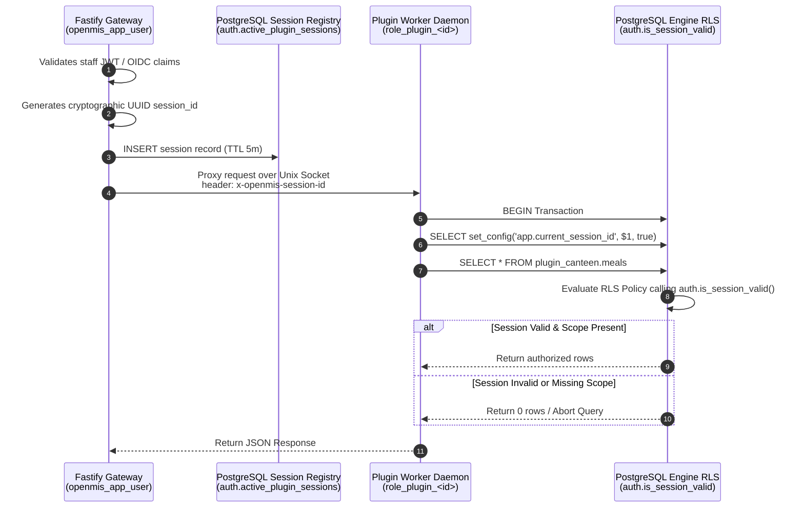

# OpenMIS UK: Performance Optimization Specification & Runbook

> **Status:** Active Reference Specification  
> **Target Audience:** Database Administrators, Performance Engineers, AI Agents  
> **Related Specifications:** [Architecture](./architecture.md) | [Security](./security.md) | [Performance](./performance.md)

---

## Table of Contents

- [1. Worker Execution: Long-Lived Daemons over Unix Domain Sockets](#1-worker-execution-long-lived-daemons-over-unix-domain-sockets)
- [2. Attendance & Classroom Roster Batching](#2-attendance--classroom-roster-batching)
- [3. Database Connection Quotas & Dynamic Role Governance](#3-database-connection-quotas--dynamic-role-governance)
- [4. In-Database Session Registration & Zero-Trust RLS Governance](#4-in-database-session-registration--zero-trust-rls-governance)
  - [The Core Invariant](#the-core-invariant)
  - [Session Registry Schema & Privilege Isolation](#session-registry-schema--privilege-isolation)
  - [End-to-End Request Execution Flow](#end-to-end-request-execution-flow)
  - [Engine-Level Security Function (SECURITY DEFINER)](#engine-level-security-function-security-definer)
  - [Row-Level Security (RLS) Policy Binding](#row-level-security-rls-policy-binding)
  - [Defense-in-Depth & Dynamic Role Attributes](#defense-in-depth--dynamic-role-attributes)
- [5. Parent Traffic Decoupling: CQRS Read Snapshots](#5-parent-traffic-decoupling-cqrs-read-snapshots)
- [6. Bulk Document Generation & Storage Pipeline](#6-bulk-document-generation--storage-pipeline)
- [7. Outbound Egress Optimization](#7-outbound-egress-optimization)

---

## 1. Worker Execution: Long-Lived Daemons over Unix Domain Sockets

### The Problem
Ephemeral child process spawning on interactive read paths incurs **30–80 ms of process startup overhead**, V8 initialization penalties, and continuous database connection thrashing during peak morning roll-call windows.

### Execution Architecture
* Interactive and read-heavy workers run as **persistent child process daemons** (`node:child_process`) managed by a supervisor process inside the dedicated school container.
* Fastify acts as an unprivileged reverse proxy, forwarding requests to the worker daemon via a dedicated local Unix Domain Socket (e.g., `/run/openmis/plugin-<id>.sock`) using HTTP/1.1 or NDJSON streaming.

### Worker Memory & Lifecycle Limits
* Daemons run with explicit V8 memory limits (`--max-old-space-size=64`).
* Idle daemons unreference non-critical timers; persistent Resident Set Size (RSS) is bounded to **~30–35 MB** per active plugin daemon.
* An automated soft restart occurs gracefully after **10,000 processed requests** to eliminate memory leak accumulation.

---

## 2. Attendance & Classroom Roster Batching

### The Problem
Emitting individual scalar RPC lookups for each pupil in a classroom causes high IPC chatter and database index-lookup thrashing.

### Cohort-First Contract
All plugin RPC endpoints must accept cohort arrays by default rather than scalar inputs:

```typescript
// Standard RPC Payload Contract
interface CohortBatchRequest {
  schoolId: string;
  pupilIds: string[]; // Array of 20–35 pupil UUIDs
  context: 'attendance_register' | 'seating_chart' | 'gradebook';
}
```

### Database Query Vectorization
Plugin workers query their schemas using parameterized array checks against indexed scalar keys:

```sql
SELECT pupil_id, balance, dietary_flags
FROM plugin_canteen.balances
WHERE pupil_id = ANY($1::uuid[]);
```

Single-pupil lookups simply pass an array with a single UUID (`[id]`), avoiding branching logic while eliminating N+1 queries.

### Concurrency Limiting on Host Fastify
* The Fastify gateway enforces an in-memory queue limiter (`p-limit` set to 4–6 concurrent operations) for roll-call submissions.
* When 50 classes submit within a 5-minute bell curve, requests exceeding concurrency limits queue in memory for **<500 ms** rather than saturating host container CPU.

---

## 3. Database Connection Quotas & Dynamic Role Governance

### The Problem
Plugin connection pool proliferation can exhaust PostgreSQL backend connection slots, starving critical attendance marks and child protection writes (`pupil_safeguarding_notes`).

### PostgreSQL Engine-Level Quotas
Statutory core and plugin roles enforce hard engine connection limits:

```sql
-- Statutory core guaranteed connection quota
ALTER ROLE openmis_app_user CONNECTION LIMIT 25;

-- Dynamic per-plugin dedicated worker role quota (provisioned by openmis_migrator at install)
CREATE ROLE role_plugin_uk_openmis_canteen WITH LOGIN NOSUPERUSER NOCREATEROLE NOBYPASSRLS NOINHERIT CONNECTION LIMIT 5;
```

### Zero-Minimum Idle Pooling (`min: 0`)
* Plugin daemons must configure their Drizzle / `pg.Pool` instances with `min: 0` and `idleTimeoutMillis: 30000`.
* When no staff members are actively viewing a plugin’s surface, its database connections drop to zero.

### Dynamic Pool Overrides
* Admins and vendors can adjust plugin pool limits via the settings dashboard.
* Adjustments transmit over the Unix socket via an administrative control frame (`UPDATE_POOL_CONFIG`), prompting the daemon to resize its pool without process termination.
* Fastify enforces a validation ceiling preventing the sum of configured plugin pools from exceeding the 30-connection role limit.

---

## 4. In-Database Session Registration & Zero-Trust RLS Governance

### The Core Invariant
Application-layer cryptographic checks (e.g., verifying Ed25519 JWTs inside the Node.js worker) fail to protect the system if a worker daemon process is compromised or executes arbitrary SQL under its database credentials. To guarantee complete data isolation, **PostgreSQL itself must validate identity and scopes on every query transaction before any row data is evaluated or returned**.

Rather than utilizing compute-heavy cryptographic operations (`pgjwt` / `pgcrypto`) inside PL/pgSQL, session capabilities are pre-registered directly into an internal PostgreSQL table by the trusted host before requests are dispatched over the local Unix domain socket.

### Session Registry Schema & Privilege Isolation

The session table is housed within an internal schema accessible only by the trusted Fastify host (`openmis_app_user`) and strictly read-limited for plugin workers (`role_plugin_<id>`):

```sql
CREATE SCHEMA IF NOT EXISTS auth;

-- 1. Ephemeral Unlogged Session Registry
-- UNLOGGED eliminates write-ahead log (WAL) churn during high-frequency morning roll-calls
CREATE UNLOGGED TABLE auth.active_plugin_sessions (
  session_id UUID PRIMARY KEY DEFAULT gen_random_uuid(),
  plugin_id TEXT NOT NULL,
  user_id UUID NOT NULL,
  authorized_scopes TEXT[] NOT NULL,
  expires_at TIMESTAMPTZ NOT NULL
);

-- Index for sub-millisecond primary key lookups and TTL eviction
CREATE INDEX idx_active_sessions_lookup
  ON auth.active_plugin_sessions (session_id, plugin_id)
  WHERE expires_at > clock_timestamp();

-- 2. Privilege Boundary
-- Only the trusted Fastify core host can mint, update, or delete sessions
GRANT USAGE ON SCHEMA auth TO openmis_app_user;
GRANT ALL ON auth.active_plugin_sessions TO openmis_app_user;

-- Plugin daemons can ONLY query sessions; they cannot write, update, or forge rows
GRANT USAGE ON SCHEMA auth TO role_plugin_uk_openmis_canteen;
GRANT SELECT ON auth.active_plugin_sessions TO role_plugin_uk_openmis_canteen;
```

### End-to-End Request Execution Flow



### Engine-Level Security Function (`SECURITY DEFINER`)

Session validation executes inside PostgreSQL using an immutable, sandboxed validation function configured to prevent search-path injection attacks:

```sql
CREATE OR REPLACE FUNCTION auth.is_session_valid(
  required_scope TEXT,
  calling_plugin_id TEXT
)
RETURNS BOOLEAN
SECURITY DEFINER
SET search_path = auth, pg_temp
LANGUAGE sql
STABLE
AS $$
  SELECT EXISTS (
    SELECT 1
    FROM auth.active_plugin_sessions s
    WHERE s.session_id = NULLIF(current_setting('app.current_session_id', true), '')::uuid
      AND s.plugin_id = calling_plugin_id
      AND s.expires_at > clock_timestamp()
      AND required_scope = ANY(s.authorized_scopes)
  );
$$;
```

### Row-Level Security (RLS) Policy Binding

Tables requiring scope authorization (including plugin tables and authorized core views) apply RLS policies bound directly to the validation function:

```sql
-- Enable RLS on protected plugin schema tables
ALTER TABLE plugin_canteen.meals ENABLE ROW LEVEL SECURITY;
ALTER TABLE plugin_canteen.balances ENABLE ROW LEVEL SECURITY;

-- Enforce session scope on SELECT operations
CREATE POLICY canteen_meals_read_policy ON plugin_canteen.meals
  FOR SELECT
  TO role_plugin_uk_openmis_canteen
  USING (
    auth.is_session_valid('canteen:read', 'uk.openmis.canteen')
  );

CREATE POLICY canteen_balances_write_policy ON plugin_canteen.balances
  FOR ALL
  TO role_plugin_uk_openmis_canteen
  USING (
    auth.is_session_valid('canteen:admin', 'uk.openmis.canteen')
  );
```

### Defense-in-Depth & Dynamic Role Attributes

* **Zero Scope Tampering:** Because `role_plugin_<id>` has zero write access to `auth.active_plugin_sessions`, a compromised worker daemon cannot grant itself extra scopes or alter its assigned `user_id`.
* **Dynamic Role Isolation (`CURRENT_USER`):** On `auth.active_plugin_sessions`, RLS maps `plugin_id = substring(CURRENT_USER from 'role_plugin_(.*)')`. Each daemon is completely blind to session tokens belonging to other plugins.
* **Instant Session Revocation:** Fastify revokes access immediately by deleting the session row (`DELETE FROM auth.active_plugin_sessions WHERE user_id = $1`), terminating active worker DB operations in real time without waiting for token TTL expirations.
* **Low Latency & Zero WAL Churn:** Operating on an `UNLOGGED` table with an in-memory index keeps session lookups below **0.05 ms** inside PostgreSQL's shared buffers.

---

## 5. Parent Traffic Decoupling: CQRS Read Snapshots

### The Problem
Consumer-grade burst traffic (1,800–2,400 parents responding to push notifications or end-of-day attendance alerts) will crash container runtimes if routed through plugin daemons.

### Zero-Plugin Read Path
Parent requests never touch plugin child processes, Unix domain sockets, or third-party execution boundaries.

### Pre-Aggregated JSON Snapshots
Mutation workflows in plugins write read-optimized projection snapshots into an indexed core-accessible cache table upon state changes:

```sql
CREATE TABLE public.parent_student_snapshots (
  student_id UUID NOT NULL,
  module_key TEXT NOT NULL, -- e.g., 'canteen', 'attendance_summary'
  snapshot_data JSONB NOT NULL,
  updated_at TIMESTAMPTZ NOT NULL DEFAULT NOW(),
  PRIMARY KEY (student_id, module_key)
);
```

Parent API endpoints serve pre-baked JSON directly via indexed primary key lookups, completing in **<5 ms** with zero plugin runtime overhead.

---

## 6. Bulk Document Generation & Storage Pipeline

### Direct S3 Multipart Streaming
* PDF generation buffers must not accumulate entirely in container memory before upload.
* Renders stream output chunks directly to cloud object storage using `@aws-sdk/lib-storage` (`Upload` abstraction) via `stream.PassThrough`.

### Presigned URL Offloading
* Fastify never streams generated PDF bytes back to client browsers through application containers.
* Clients receive short-lived (15-minute) presigned S3/R2 download URLs, offloading high-bandwidth file delivery directly to cloud storage and CDN edge nodes.

### Statutory Task Throttling
* Bulk statutory runs (e.g., 1,500 end-of-term school reports) run exclusively via `pg-boss` on the dedicated statutory queue.
* Concurrency is throttled to 2–4 simultaneous document compilations to keep container CPU available for classroom attendance registers.

---

## 7. Outbound Egress Optimization

### DNS Caching for Secure Dispatcher
* The custom `undici.Agent` SSRF guard retains IP-pinning and private range validation (`ipaddr.js`), but wraps hostname resolution in a high-performance in-memory TTL cache (5-minute expiry).
* Eliminates redundant, asynchronous `dns.resolve()` network round-trips on every outbound API call while preventing DNS rebinding attacks.
